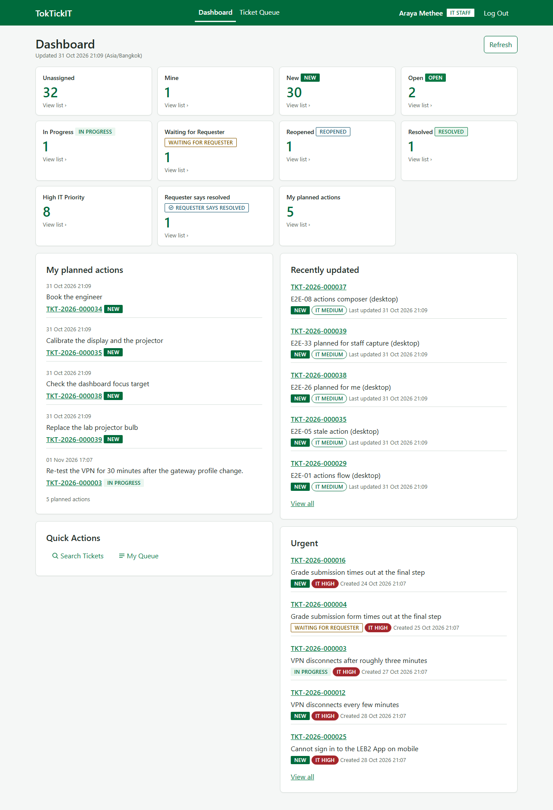
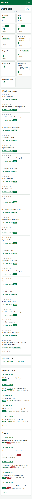
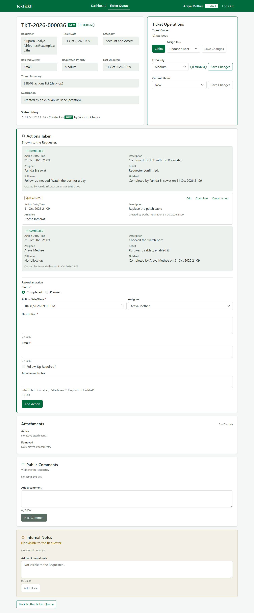
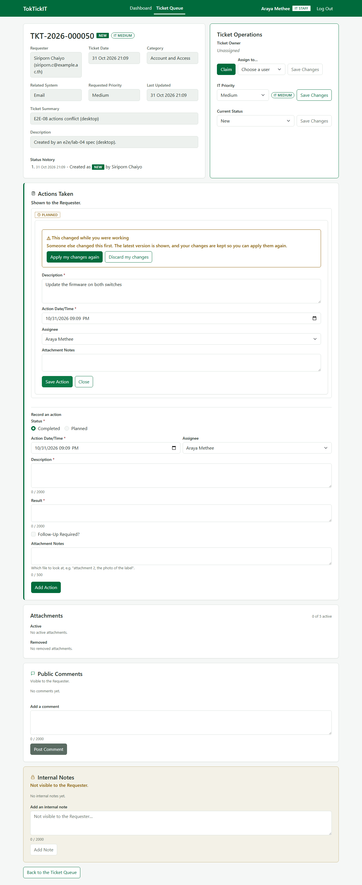
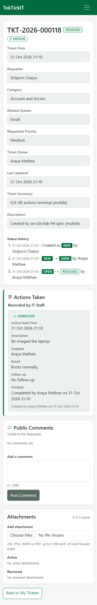
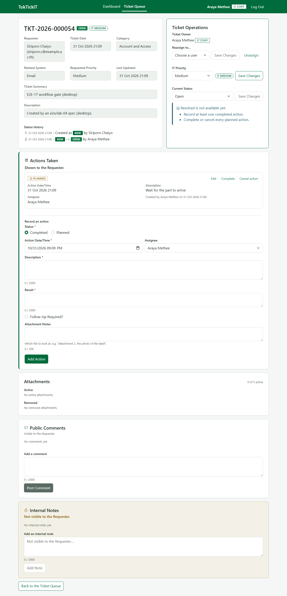
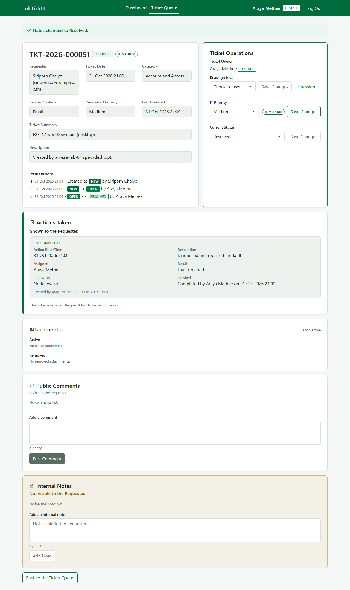
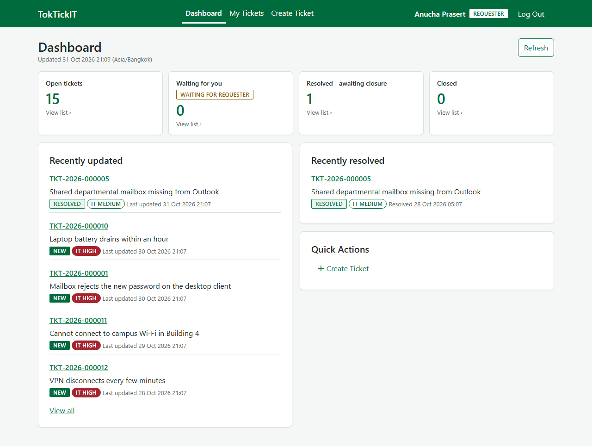
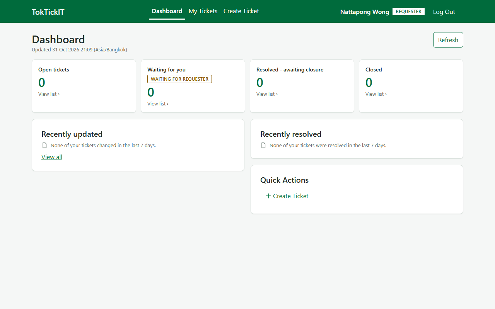
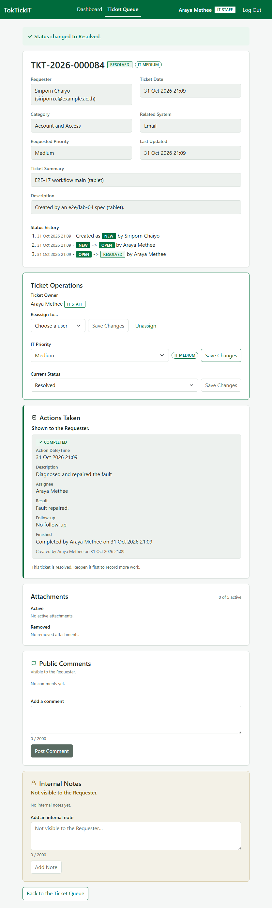

# Lab 4 Report - TokTickIT

CPE 334 Individual Sprint 4 (LS 14). Author: Tammathorn Kananurak (67070503489).
Repository: <https://github.com/Tammathorn/toktickit>. State at writing: **31 October 2026, before
review and before the release.** The Lab 4 PRs (#72 to #80 and the documentation PR of Issue #71)
are open and stacked on each other; nothing has been merged, `lab4-staging` has no Lab 4 code and `main`
is still the Lab 3 release. So every figure below is for the stack's tip, `feature/lab4-9-e2e-visual` at
`6ccf79d` (the documentation branch adds only documents), and **the Part 3 run on `main` after the release
merge is not yet done and is not claimed.** Where something was not done or not proven, the row says so.

One green run of each suite on that code: server **510** passed (21 files), client **193** passed (15 files),
Playwright **413** passed and **37** skipped (450 runs), performance smoke **2** passed
([`evidence/issue-71/`](evidence/issue-71/README.md)). Paths in this Markdown file are relative to
`artifacts/lab-04/`; [`evidence.md`](evidence.md) is the index that maps every row to its file.

## Answer Part 1

*Git use with engineering workflow.*

| Row | Evidence |
|---|---|
| P1-01 | Branches `feature/lab4-1-contract` to `feature/lab4-10-release-docs`, one per Issue, each PR's base the branch below it (the stack is stated in each body): [`evidence/issue-71/github-my-prs-readback.txt`](evidence/issue-71/github-my-prs-readback.txt); history with dates: [`evidence/issue-71/git-log-contract-to-release.txt`](evidence/issue-71/git-log-contract-to-release.txt) |
| P1-02 | Short prefixed commits (`test:` first, then `feat:`, then `docs:`) per Issue, each subject carrying the Issue number; no co-author trailer (`CLAUDE.md`) |
| P1-03 | Peer review in both directions, read back from GitHub: [`../../docs/lab-04/reviewer.md`](../../docs/lab-04/reviewer.md); raw: [`evidence/issue-71/github-partner-prs-readback.txt`](evidence/issue-71/github-partner-prs-readback.txt) |
| P1-04 | **Reviews of my PRs: none yet.** #72-#80 have 0 reviews, 0 comments and no requested reviewer. Nothing is merged, and I have not self-merged anything |
| P1-05 | **Reviews I gave:** PAKATO123/toktickit #63 and #64 approved, #65 and #70 changes requested (31 Oct 04:44 to 04:55 UTC). He replied to #64, #65 and #70 on GitHub; I have not re-reviewed. Comments and replies are quoted in `reviewer.md` section 3 |
| P1-06 | Board columns: **no GitHub board screenshot is in the repository**; none was taken for Lab 4. No card has entered **Fixing**, since no review has asked for a change on my PRs. This is a gap |
| P1-07 | The release PR (`lab4-staging` into `main`) is **not opened**; it waits for every feature PR to merge |
| P1-08 | [`../../README.md`](../../README.md) has a Lab 4 section; `.gitignore` keeps `tmp/`, uploads, `e2e/.auth/` and test output out of the repository |

## Answer Part 2

*Specification-driven development.*

| Row | Evidence |
|---|---|
| P2-01 | The contract: [`specification.md`](../../docs/lab-04/specification.md) (148 acceptance criteria), [`api-spec.md`](../../docs/lab-04/api-spec.md), [`ui-spec.md`](../../docs/lab-04/ui-spec.md), [`tests.md`](../../docs/lab-04/tests.md) (304 planned tests), [`decisions.md`](../../docs/lab-04/decisions.md) (C-122 to C-198; C-196 unused) |
| P2-02 | The contract was committed before any code: its commits are dated 12 to 15 October and 28 October 07:53 UTC; the first code commit, `2b7e2b0`, is 28 October 15:35 +07:00 and has the contract's last commit, `3bfade9`, as an ancestor ([`evidence/issue-71/git-log-contract-to-release.txt`](evidence/issue-71/git-log-contract-to-release.txt)) |
| P2-03 | **The contract PR #72 is not merged.** `CLAUDE.md` rule 1 (contract merged into `lab4-staging` before Issue 2 starts) was relaxed for the deadline: #73 to #80 are stacked on the unmerged #72. A merged PR page that proves "spec before code" does not exist yet |
| P2-04 | Decisions made after the contract, each a row with its reason: C-190 to C-195, C-197 and C-198. They also correct `specification.md`, `api-spec.md`, `ui-spec.md` and `tests.md` where the built system differed (C-190 the row lock, C-191 the 422 envelope, C-192 the empty-edit message, C-193 `updatedAt`, C-194 the replay scope) |
| P2-05 | Conflicts between an instruction and the code were recorded rather than resolved silently, e.g. C-158's cut (Ticket create ignores `clientRequestId`, WF-64) against a later instruction that it keeps the key: `decisions.md` C-158 and C-194 |

## Answer Part 3

*Test-driven development and traceability.*

| Row | Evidence |
|---|---|
| P3-01 | Plan: 304 planned tests across ten levels, each row naming its file: [`tests.md`](../../docs/lab-04/tests.md) section 2; traceability of the 148 criteria in section 3 |
| P3-02 | Red then green per Issue: #63 [`evidence/issue-2/red-migration.txt`](evidence/issue-2/red-migration.txt) (33 failed) and [`green-migration.txt`](evidence/issue-2/green-migration.txt); #64 [`evidence/issue-64/red-actions-authorization.txt`](evidence/issue-64/red-actions-authorization.txt) (62 failed) and [`green-actions-authorization.txt`](evidence/issue-64/green-actions-authorization.txt); #65 [`evidence/issue-65/red-client-suite.txt`](evidence/issue-65/red-client-suite.txt); #66 [`evidence/issue-66/red-ticket-workflow.txt`](evidence/issue-66/red-ticket-workflow.txt) (44 failed); #67 [`evidence/issue-67/red-staff-dashboard-server.txt`](evidence/issue-67/red-staff-dashboard-server.txt) (24 of 24 failed). **#68 and #69 have no red run:** the code came with #67's patch, and the #69 skeleton test was seen red but not saved; their READMEs say so |
| P3-03 | Final results with counts and the `Final` column: [`tests.md`](../../docs/lab-04/tests.md) sections 2, 4.4 and 6; output [`evidence/issue-71/green-server-suite.txt`](evidence/issue-71/green-server-suite.txt) (510), [`green-client-suite.txt`](evidence/issue-71/green-client-suite.txt) (193), [`green-e2e-suite.txt`](evidence/issue-71/green-e2e-suite.txt) (413 + 37 skipped), [`perf-smoke.txt`](evidence/issue-71/perf-smoke.txt) (p95 5.9 and 10.2 ms) |
| P3-04 | Not every planned row exists as a test: UI-50, UI-52, STYLE-03, 04, 05, 07, 08 and RESP-01..RESP-11 were not written for the deadline, and eleven client rows assert less than their row. Each is named in `tests.md` 6.1 and in its `Final` cell |
| P3-05 | Labs 1-3 regression: the counts before Lab 4 (297 / 128 / 278 + 34) are unchanged and nothing was deleted or skipped; 28 server, 9 client and 20 e2e Lab 2/3 tests were adapted, each citing its decision: `tests.md` section 4 |
| P3-06 | Migration: rehearsal on the Lab 3 dump, counts equal before and after, backfill all zero, zero drift, backup restore test: [`evidence/issue-2/`](evidence/issue-2/README.md); zero drift again on the fresh database of the final run: [`evidence/issue-71/final-db-drift.txt`](evidence/issue-71/final-db-drift.txt) |
| P3-07 | Flake evidence kept: the sporadic e2e sign-in `ECONNRESET` (six runs over #64 to #70, each rerun green) and the 4.7-hour host stall in #66, beside the green runs; `tests.md` 6.3 lists the files |
| P3-08 | **All suites on `main` after the release merge: not done.** It can only run once the release PR has merged |

## Answer Part 4

*AI use with reflection.*

| Row | Evidence |
|---|---|
| P4-01 | [`../../docs/lab-04/ai-use.md`](../../docs/lab-04/ai-use.md): the two Claude roles (planner and executor), the key prompts marked **(key)** with what I did with each result, the prompts of the seven bridge tasks and what went wrong in each (section 2.8), and what the AI could not do |
| P4-02 | **"My Reflection" is an empty heading**, to be written by me in my own words before submission. It is not yet written |

## Answer Part 5

*Working IT Staff and Administrator Dashboard.*

| Row | Evidence |
|---|---|
| P5-01 | Eleven staff cards and three user cards, each with a drill-down whose list total equals the count, one API test per card: [`evidence/issue-67/green-staff-dashboard-server-verbose.txt`](evidence/issue-67/green-staff-dashboard-server-verbose.txt) (API-60..API-81) |
| P5-02 | Metrics match the database: one `psql` query per card beside the API JSON of the same moment: [`evidence/issue-67/part5-staff-cards.sql`](evidence/issue-67/part5-staff-cards.sql), [`part5-psql-staff-cards.txt`](evidence/issue-67/part5-psql-staff-cards.txt), [`part5-api-staff-dashboard-it-staff.json`](evidence/issue-67/part5-api-staff-dashboard-it-staff.json), [`part5-api-staff-dashboard-administrator.json`](evidence/issue-67/part5-api-staff-dashboard-administrator.json), [`part5-api-drilldown-totals.json`](evidence/issue-67/part5-api-drilldown-totals.json) |
| P5-03 | Role restriction: a Requester calling `GET /api/dashboard/staff` gets 403 with no metric content (SEC-05, same verbose output), and a Requester's own `/dashboard` shows only Requester cards ([`screenshots/requester-dashboard/requester-dashboard-desktop-populated.png`](screenshots/requester-dashboard/requester-dashboard-desktop-populated.png)); a forbidden dashboard UI state cannot occur (C-180) |
| P5-04 | Count equals list in the browser, every card clicked, for IT Staff and Administrator at three widths: E2E-23, [`evidence/issue-70/card-vs-list-it-staff-desktop.json`](evidence/issue-70/card-vs-list-it-staff-desktop.json) and the other 11 files in that folder |
| P5-05 | Performance smoke on 2,000 Tickets and 5,000 actions: [`evidence/issue-71/perf-smoke.txt`](evidence/issue-71/perf-smoke.txt) |
| P5-06 | Screens at three widths: [`screenshots/staff-dashboard/`](screenshots/staff-dashboard/README.md) (24 files; `-lists-empty-mocked` is the one mocked state and says so, `-failure` is a declared mocked 500) |

## Answer Part 6

*Working Actions Taken UI and API.*

| Row | Evidence |
|---|---|
| P6-01 | API: create planned and completed, edit, complete, cancel, field rules, assignee eligibility, replay including five concurrent creates, check order, `STALE_UPDATE`: [`evidence/issue-64/green-actions-authorization.txt`](evidence/issue-64/green-actions-authorization.txt); inside the final run [`evidence/issue-71/green-server-suite.txt`](evidence/issue-71/green-server-suite.txt) (57 tests in `actions-taken.api.test.ts`) |
| P6-02 | A Requester's `POST /api/tickets/:id/actions` is 403 with no action created, anonymous is 401, a foreign Origin is 403: SEC-01..SEC-04 and SEC-10..SEC-12 in the same output; in the browser E2E-10 |
| P6-03 | The inactive assignee is 422 (E2E-04, API-07, API-08); the 422 carries no `fields` key and the screen places the message at the Assignee field (C-191) |
| P6-04 | Two browser contexts, a real 409, and `Apply my changes again` sending only the user's own changes: E2E-05, UI-34 |
| P6-05 | Fifteen states at three widths from the real app: [`screenshots/actions-taken/`](screenshots/actions-taken/README.md) (45 files). The Requester read-only view is `actions-<viewport>-requester.png` |
| P6-06 | Not done for the deadline: focus management and `aria-describedby` in the row panels, and a table at `lg` (the screen draws cards at every width, C-195): `tests.md` 6.1 |

## Answer Part 7

*Ticket workflow: the resolution gate, stale updates, append-only history.*

| Row | Evidence |
|---|---|
| P7-01 | Gate, the seven-step status order, `version` and `STALE_UPDATE`, `lastActivityAt` per write path, `resolvedAt`, status history (WF-01..WF-64): [`evidence/issue-66/green-server-suite.txt`](evidence/issue-66/green-server-suite.txt); final run [`evidence/issue-71/green-server-suite.txt`](evidence/issue-71/green-server-suite.txt) (68 tests in `ticket-workflow.api.test.ts`) |
| P7-02 | The bypass attempt: a raw `PATCH` to Resolved without a completed action is 409 `RESOLUTION_GATE_NOT_MET` with `reasons`; cancelling with a planned action is 409 `PLANNED_ACTIONS_OPEN` (WF rows; E2E-12, E2E-13) |
| P7-03 | The row lock is `SELECT ... FOR UPDATE` and a refused write leaves no trace (C-190); the concurrency test fires competing writes 20 times (WF-32) |
| P7-04 | History is append-only and oldest first, with the creation row; a legacy Ticket shows the C-179 line (captured from `toktickit_rehearsal`) |
| P7-05 | Screens at three widths: [`screenshots/ticket-workflow/`](screenshots/ticket-workflow/README.md) (30 files) |
| P7-06 | Known limits: re-assigning the current owner is a write (C-197); comment, attachment and action writes also move `Ticket.updatedAt` but not `version` (C-193); the two race fixes of the #66 audit have no deterministic test |

## Answer Part 8

*Requester Dashboard and Labs 1-3 regression.*

| Row | Evidence |
|---|---|
| P8-01 | Four cards and two lists, each count equal to its `GET /api/tickets` drill-down; A cannot see B's numbers; the zero-Ticket Requester (nattapong.w) shows every card 0: [`evidence/issue-68/green-requester-dashboard-server-verbose.txt`](evidence/issue-68/green-requester-dashboard-server-verbose.txt) (API-49..API-59, SEC-06, SEC-08, SEC-13) |
| P8-02 | Every route is in the authorization matrix and every matrix row is registered (36 rows): SEC-09, same file |
| P8-03 | API-57 failed once on stale rows in `toktickit_test`; the test database alone was dropped and rebuilt, nothing weakened (C-198): [`evidence/issue-68/first-run-api57-stale-test-db.txt`](evidence/issue-68/first-run-api57-stale-test-db.txt), [`test-db-rebuild-drop.txt`](evidence/issue-68/test-db-rebuild-drop.txt) |
| P8-04 | Regression of the Lab 2 and Lab 3 screens on the Lab 4 build, 14 states at three widths plus the nine navigation-with-Dashboard captures: [`screenshots/regression/`](screenshots/regression/README.md) (51 files); the unchanged Lab 1-3 test counts are in Part 3 |
| P8-05 | Requester dashboard states at three widths: [`screenshots/requester-dashboard/`](screenshots/requester-dashboard/README.md) (15 files) |

## Answer Part 9

*Zen Green UI, responsive and accessibility evidence, hardening.*

| Row | Evidence |
|---|---|
| P9-01 | The visual and accessibility checklist VIS-01..VIS-32, every value measured in the running app at 1280, 834 and 390 px (all 32 pass; the first measurement found five real defects, fixed in `theme.css`): [`evidence/issue-70/visual-checklist.md`](evidence/issue-70/visual-checklist.md); raw values [`visual-measurements-desktop.json`](evidence/issue-70/visual-measurements-desktop.json), [`-tablet`](evidence/issue-70/visual-measurements-tablet.json), [`-mobile`](evidence/issue-70/visual-measurements-mobile.json) |
| P9-02 | The console-error fixture fails a test on `console.error`, a page error or a same-origin 5xx; E2E-28..E2E-32 prove both halves: [`evidence/issue-69/fixture-failure-messages.txt`](evidence/issue-69/fixture-failure-messages.txt) |
| P9-03 | End to end across three viewports: [`evidence/issue-71/green-e2e-suite.txt`](evidence/issue-71/green-e2e-suite.txt) (413 passed, 37 skipped; the skips are 34 from before Lab 4 and the three `legacy-history` runs) |
| P9-04 | 165 screenshots from the real app in five folders, each with a README; the only mocked states are named (`-lists-empty-mocked`, the `-failure` captures): [`screenshots/`](screenshots/) |
| P9-05 | **The RESP-01..RESP-11 tests were not written** as separate tests; the same properties (scroll, clipping, overlap, touch targets, grid columns, keyboard order) are measured by VIS-24, VIS-25 and VIS-28..VIS-32 instead, and the Actions Taken layout and the dashboard panels at three widths are shown by screenshots only: `tests.md` 6.1 |
| P9-06 | Hardening cut for the deadline: the client audit, focus management, UI-50 and the test gaps; `clientRequestId` on Ticket create stays cut (C-158). All recorded in `tests.md` 6.1 |

